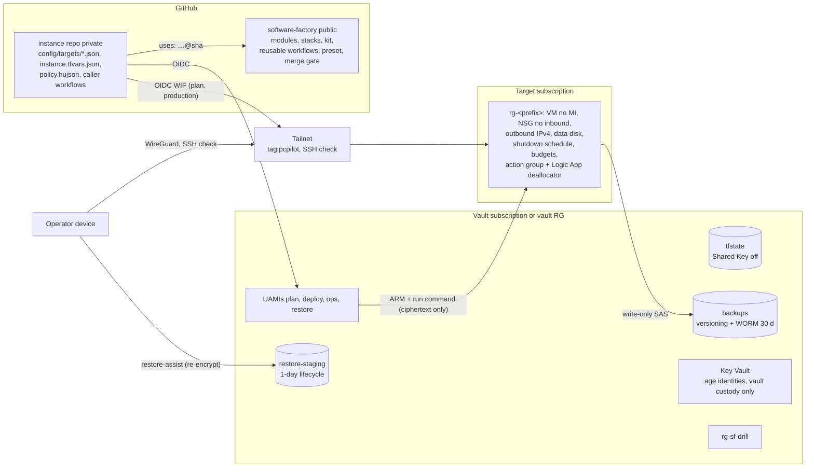

# ADR 0001: Deploying Paperclip and Hermes to Azure (revision 3)

- **Status:** Proposed, 2026-11-26. Revision 3 addresses the deployment, recovery and authorization review findings on revision 2.
- **Applies to:** the proposed `hosting/paperclip-hermes/` in `software-factory`; that directory and its implementation are absent at this revision.
- **Supersedes:** the portal steps of the original pilot runbook, and revisions 1–2 of this ADR.
- **Notation:** "[V]" marks a fact verified on 2026-11-26 against a primary source. "Open" marks something that still has to be tested; each Open item has a self-test or acceptance test, and either a documented fallback or, where stated, it blocks release.

## Context

Paperclip is an agent control plane and Hermes is an agent gateway. This ADR proposes running them together as a hardened Docker Compose kit on one Linux VM. Work package WP2 imports the kit into `hosting/paperclip-hermes/kit/` as one commit whose message records the private source repository and commit. That import and this repository's control-test CI are not present at this revision. All six are **Open, not implemented or verified in this repository**:

| Proposed control | Acceptance test before a deployment release |
|---|---|
| Pinned image digests | Reject every Compose image or Dockerfile base without a digest; inspect the running image IDs against the release manifest. |
| No public inbound ports | Terraform NSG assertions plus the external scan in self-test 9. |
| Containers blocked from IMDS and WireServer | Container probes to both endpoints fail and increment the host DROP counters. |
| No VM managed identity | Assert empty managed identities in both the plan and the deployed VM's ARM response. |
| Encrypted nightly backup with a write-only upload credential | Run the timer, decrypt and restore its blob in a drill, and prove the upload SAS cannot read, list or delete. |
| Fenced restore with messaging off | Restore a seeded backup and assert that no messaging service starts or sends until an explicit unfence. |

The repository layout, scripts, workflows and tests below are implementation requirements. WP2 imports the kit into `hosting/paperclip-hermes/kit/` as one commit whose message records the private source repository and commit. Evidence for every control above comes from this repository's own unit tests and `kit-e2e` CI, which must exist and pass before release. The controls remain Open until that CI exists and supplies passing evidence. Until then, bootstrap and deployment are unavailable; there is no deployable fallback.

This ADR specifies a reusable deployment for adopters whose private repositories can enforce the required approvals. An adopter connects GitHub to an Azure subscription, runs one bootstrap script once, and then runs workflows. They get Paperclip, Hermes or both. Day-2 work is automated: upgrades, backups, credential rotation, cost guards and subscription moves.

**Constraints that shape the design:**

- **Release pace.** Paperclip ships a stable CalVer release every 1–2 weeks. Hermes ships 1–2 semver releases a week, plus daily canaries [V]. Paperclip v2026.1117.0 is declared a "rollback floor": after its migrations, an older image cannot run against the database [V]. **So rollback must restore data, not only swap the image.**
- **Spending limit.** On a subscription with a spending limit, running out of credit stops and deallocates every VM and makes storage read-only until the next billing period [V]. **So backups and Terraform state must not live in that subscription by default.**
- **Budget data lag.** Cost data lags 8–24 hours and can lag up to about 72 hours. For Visual Studio offers it is a retail estimate with no credits applied [V]. **So a budget alert is a coarse guard, not a precise one.**
- **GitHub OIDC subjects.** Repositories created after 2026-07-15 use immutable OIDC subjects (`repo:<owner>@<id>/<repo>@<id>:…`) [V]. An Azure identity holds at most 20 federated credentials, and they accept no wildcards [V]. A reusable workflow's `sub` describes the caller, not the called workflow [V].
- **Tailscale policy file.** `tailscale_acl` overwrites the whole tailnet policy file. It must be imported first [V].
- **Run command.** It needs a running VM, and whether it echoes protected parameters is unverified (Open). **So no plaintext secret ever travels through it** (decision 9).

## Decisions

1. **Public repository plus private instance repository.**
   - The public repo holds the modules, root stacks with their lock files, the kit, the reusable workflows, the bootstrap script, a Renovate preset, the merge-gate workflow and the docs.
   - Each adopter creates a private instance repo from `templates/instance/`. It holds only settings, the tailnet policy, thin caller workflows and run history.
   - *Why:* strangers write no Terraform; personal IDs never reach the public repo; upgrading means bumping one ref.
   - Private instance repos require **GitHub Enterprise** with required environment reviewers. Free, Pro and Team are unsupported for this approval model [V]; see [GitHub's reviewer availability](https://docs.github.com/en/actions/how-tos/deploy/configure-and-manage-deployments/review-deployments). Operator merges alone do not replace deployment approval gates.

2. **Three failure boundaries, with a single-subscription mode for small adopters.**
   - The *target* subscription runs the VM.
   - The *vault* holds backups, Terraform state, the Key Vault and the identities. It survives the loss of the target.
   - The *tailnet* is the third boundary.
   - `vault_mode = separate-subscription` is the default. `same-subscription` puts the vault in its own resource group in the target subscription. The bootstrap refuses that mode when the target's `subscriptionPolicies.spendingLimit` is `On`, unless `--accept-vault-risk` is passed, and the quickstart documents the risk of losing backups with the subscription.
   - *Why:* losing the target subscription, or having it disabled by its spending limit, leaves backups, state and the ability to move intact. Adopters with one subscription still have a path.

3. **Privileged resources are applied only with the operator's Owner login, through the reviewed bootstrap script.**
   - `sf-bootstrap.sh` creates the state storage account with `az`. This is the only resource made outside Terraform, because of the chicken-and-egg problem with the backend.
   - It then applies the **`trust` stack** under the operator's own login. That stack is Terraform in the public repo and holds:
     - identities, federated credentials, custom roles and role assignments, including read-only Cost Management Reader for `id-sf-ops` on each target subscription (on its target-tenant twin when tenants differ);
     - the workload resource group (in resource-group scope mode);
     - the backup storage account, with its WORM policy, lifecycle rules and locks;
     - the Key Vault.
   - The state account is imported into the stack, so everything is IaC with drift detection.
   - No workflow identity can apply `trust`. `ph-plan` plans it read-only every night. A pending diff, such as an AVM bump in a new release, opens an `ops-alert` asking the operator to run `sf-bootstrap.sh trust --apply`.
   - *Why:* a deploy identity must never be able to widen its own rights or delete backups. The cost is an operator run only when the trust stack changes, which is rare.

4. **Resource-group-scoped trust by default.**
   - In resource-group scope mode, the `trust` stack owns the empty workload RG, and the `host` stack references it with a data source (`var.rg_managed_by = "trust"`). No `import` block is needed.
   - With `--scope subscription`, the `host` stack creates the RG (`rg_managed_by = "host"`).
   - The deploy identity gets Contributor on that RG only, plus Cost Management Contributor at subscription scope for the subscription budget.

5. **No stored cloud secret anywhere.**
   - Azure uses GitHub OIDC with user-assigned identities.
   - Tailscale uses workload identity federation (`oauth_client_id` plus `audience`) [V].
   - All IDs are non-secret configuration in the private instance repo.
   - *Why:* nothing in GitHub can be leaked and replayed.

6. **Terraform state holds no long-lived secret.**
   - No `random_password`, no `tls_private_key` and no SAS goes into state.
   - The VM module is called with `generate_admin_password_or_ssh_key = false` and a public key only.
   - The only secret in state is the Tailscale join key: single-use, preauthorized, and expiring after 3,600 s [V].
   - `terraform test` asserts that the plan contains no `tls_private_key` or `random_password` resource, and CI greps the mocked plan JSON for `private_key_pem`.

7. **The upload credential is a user-delegation SAS (amends the earlier stored-policy decision).**
   - Scope: `sr=c`, `sp=cw`, valid for at most 7 days, minted with OIDC [V].
   - Shared Key is off on every storage account.
   - The delegation-key action (`generateUserDelegationKey`) is granted **at storage-account scope**, because it is an account-level action. Data actions are granted at container scope. The SAS grants only the intersection, so it can neither read, list nor delete [V].
   - Stored-policy SAS credentials are unsupported. They require a service SAS, which [Azure rejects when Shared Key is off](https://learn.microsoft.com/en-us/azure/storage/common/shared-key-authorization-prevent); [stored policies cannot bind a user-delegation SAS](https://learn.microsoft.com/en-us/rest/api/storageservices/define-stored-access-policy) [V]. If delegation minting fails, keep the existing unexpired delegation SAS, alert and retry; once it expires, refuse operations requiring a fresh off-site backup. Never enable Shared Key as a fallback.

8. **Custody of the `age` key: the long-term private key never reaches the VM or a workflow by default.**
   - The key pair is generated on the operator's device by `sf-bootstrap.sh age-key`, and the private key is never written to disk.
   - `custody = operator` is the default and is recommended. The private key lives only in the operator's password manager.
     - Restores use **per-restore re-encryption**. The restore host generates an ephemeral age key in `/run` and returns only its public recipient. On the operator's device, `sf restore-assist` streams the chosen blob through `age -d` (with the long-term key) and `age -r <ephemeral>` into a `restore-staging` container.
     - The host restores from that blob and shreds its ephemeral key.
     - The long-term key never touches the VM, ARM or GitHub.
   - `custody = vault` (opt-in) stores the key as a Key Vault secret version that only the approval-gated restore identity can read. The same re-encryption then runs on a GitHub-hosted runner, so the plaintext key and the plaintext stream are briefly in runner memory. The run requires the input `accept_runner_exposure=true` on top of the `restore` approval, and the ADR states this deviation explicitly.
   - Every blob carries the recipient fingerprint as non-secret metadata.
     - Superseded keys are kept as password-manager entries or as **enabled** Key Vault secret versions readable only by the gated restore identity and the operator during authorized custody operations. Rotation stops using them for new backups; it does not disable or expire them while a retained backup needs them. [Disabled secret versions cannot be read, even by version ID](https://learn.microsoft.com/en-us/azure/key-vault/secrets/javascript-developer-guide-enable-disable-secret) [V].
     - Retire a key only after the last backup using it has passed both its retention and lifecycle period (45 days), and inventory confirms no retained blob, version or migration copy still needs it.
     - The restore picks the key by fingerprint, resolves the recorded exact secret version URI and verifies that its derived recipient matches. An unknown fingerprint or unreadable version stops the restore with an operator alert; the restore identity cannot change secret properties.
   - Rotation is no longer needed after a restore, because the long-term key never left custody. It is a scheduled or on-suspicion action (see "Backups and key custody", "Keys").

9. **Commands reach the VM through managed run command, and machine secrets travel only as envelope-encrypted ciphertext.**
   - On first boot, cloud-init generates a host **delivery key pair**: an age X25519 key in `/etc/paperclip-hermes/delivery.key`, root, mode 0600, never included in backups.
   - `ph-deploy` reads the public recipient through run command and records it as the VM tag `sf-delivery-recipient`. Only the deploy identity can write tags.
   - Workflows encrypt the SAS and the join key to that recipient and pass only ciphertext, as named parameters. `sfctl` decrypts on the host.
   - A recipient that no longer matches the tag raises an alert, and nothing is delivered.
   - Every workflow deletes its run-command resources when it finishes.
   - *Why:* CI never joins the tailnet, so "only the operator reaches the VM" stays literally true. If run command echoes parameters in GET, the Activity Log or `/var/lib/waagent`, only ciphertext is exposed. Self-test 1 becomes defence in depth instead of a blocker, and no weekly manual fallback exists.
   - Human secrets never use this path (decision 12).

10. **Upgrades are detected by Renovate and deployed in a fixed order: off-site backup → Terraform apply → kit upgrade with a local rollback point → health check → automatic rollback.**
    - Existing VMs retain their creation-time bootstrap `custom_data`, with no release SHA. Every later kit SHA reaches the host only through the upgrade protocol.
    - To create the rollback point, stop application writers (Paperclip, Hermes, sandbox and Caddy), dump the still-running PostgreSQL with `pg_dump`, then stop PostgreSQL before archiving volumes. Skip the database steps when Paperclip is not installed.
    - Rollback restores the local plaintext rollback point (a database dump plus the volumes) after checking out the previous kit commit.
    - Terraform changes cannot be rolled back automatically. Destructive plans are therefore refused before apply (see "Upgrades").
    - Renovate rather than Dependabot, because it can share one preset across instance repos, update tag@digest pins and refresh lock files, and its Terraform support covers versions beyond 1.15 [V].

11. **Approval model and merge gate.**
    - **Environments.**
      - `production` and `restore` need the operator's approval and are limited to `main`.
      - `ops` is unattended and limited to `main`.
      - `plan` is unattended with **no branch restriction**, because its identities are read-only, so PR plans work.
    - **Self-review.** In single-operator mode, `init` leaves "prevent self-review" **off**, because GitHub would otherwise block the operator from approving any run they triggered. It is turned on only when `--reviewer` lists two or more people. The documented convention is that agents, not the operator, trigger the runs the operator approves.
    - **CODEOWNERS** in the instance repo:
      - The operator owns `.github/**`, `config/**` and `config/tailnet/**`.
      - The callers `.github/workflows/ph-*.yml` have **no code owner**. They are protected by `sf-merge-gate` instead.
    - **`sf-merge-gate`** is an **organisation ruleset "required workflow"**. It comes from a repo the PR cannot change, at a SHA pinned in the ruleset; for agenticcodingops that is `software-factory` at a release SHA. The gate:
      - passes a PR that touches only `ph-*.yml` callers, where each change is only a `uses: …@<sha> # vX.Y.Z` line pointing to a tagged `software-factory` release;
      - also requires, for each **per-target ops-plane caller entry** (`ph-ops`, `ph-power`, `ph-cost-guard`, `ph-backup-verify`), that `<sha>` equals that entry's target VM tag `sf-approved-sha`, read with the plan identity; each entry has a fixed target input and its own literal `uses:` SHA;
      - for any other change to `ph-*.yml`, requires an approving review from a CODEOWNER.

      A PR that adds a job named like the gate does not satisfy it, because the ruleset binds the workflow file and its source repo, not a check name.
    - **Which code can reach root on the VM.** Renovate bumps only the production-plane callers. Terraform passes through all existing protocol tags unchanged (see "Terraform modules", "Details"); only the approved `ph-deploy` finish step publishes the new `job_workflow_sha`, after kit health and the port scan pass. For that target only, it first records the previous approved SHA in `sf-recovery-sha` with `sf-recovery-until` (24 h maximum), then writes the new approved SHA and pushes a bump of that target's four ops-plane caller entries. Other targets' caller refs and approval tags stay unchanged. The previous SHA may run only the recovery commands defined under "Upgrades" during that target's handoff. An agent opens the PR and the gate verifies the new SHA against that target. No candidate SHA gains unattended root before a successful approved deploy.
    - **Without org required workflows.** If the Enterprise organisation cannot enforce the required workflow, there is no agent self-merge for `ph-*.yml` changes: the operator merges them. `init` detects this separately from deployment reviewer protection, which remains mandatory.
    - **Two-bot rule in the instance repo.** Each adopter decides; the recommended default is that a gate-verified ref bump is a mechanical carve-out, because the referenced code passed the two-bot rule in the public repo. Every other instance PR needs two bots or the operator. The template ships an optional `claude.yml` for adopters who want bot review there.

12. **Human secrets go over Tailscale SSH in check mode.**
    - Interactive form: `tailscale ssh -t admin@<host> sudo sfctl secret set <name>`. The `-t` allocates a TTY so the prompt does not echo.
    - Piped form: `<pm-cli read …> | tailscale ssh admin@<host> sudo sfctl secret set <name> --stdin`. `sfctl` refuses a non-TTY stdin without `--stdin`.
    - `sfctl` writes atomic 0600 files into the kit's `.secrets/` directory under names listed in `SECRET_FILES`, so backups carry them, encrypted. It then regenerates `compose.env` or the `*_FILE` mounts so each secret reaches only its service.
    - For a GitHub token, `sfctl` calls `GET https://api.github.com/` from the host and records the `github-authentication-token-expiration` header as the real expiry.
    - *Why:* the secret goes straight from the operator's device to the file over WireGuard, and check mode forces a fresh sign-in.

13. **Cost guards are layered and sized to real headroom and to the real billing period.**
    - **Headroom** = the monthly credit minus the forecast spend of the *other* resources in the target subscription, over the billing period set by `billing_period_start_day`.
    - Deploy refuses when the headroom is less than one week of the chosen run hours, unless `override_cost` is set.
    - The other layers:
      - auto-shutdown;
      - an enforced daily run time;
      - a 14-hour uptime cap;
      - budget-driven deallocation;
      - `ph-cost-guard`, which is authoritative and queries usage and forecast using `id-sf-ops` with read-only Cost Management Reader on each target subscription;
      - an approval-gated **park** tier for when deallocation is not enough.

14. **App selection.**
    - `apps = ["paperclip","hermes"]`, or either one alone, maps to Compose profiles.
    - The default size is `Standard_B4as_v2` for both apps and `Standard_B2as_v2` for one.
    - `vm_size`, `location` and the subscription are per-target settings.

15. **One host at a time, one operation at a time.**
    - All VM-touching operations share the GitHub concurrency group `sf-host-<target>` with `cancel-in-progress: false` and `queue: max`. [GitHub retains up to 100 pending entries and cancels additional arrivals](https://docs.github.com/en/actions/how-tos/write-workflows/choose-when-workflows-run/control-workflow-concurrency) [V]. Hold the group once for the whole operation; nested jobs must not acquire the same group and deadlock their parent. Recheck state and shutdown deadlines when execution starts, since dispatch order is not guaranteed.
    - A separate `workflow_run` completion monitor, outside the host group and with no VM credentials, alerts on cancelled host runs with a run link and the requested operation. The scheduled monitor also reconciles requested stops against completed stops, surfaces queue overflow in the Status issue and retries an outstanding stop once capacity is available. A cancelled stop must never be reported as completed.
    - Acceptance (Open): hold a restore, queue a stop, then queue ops; both pending operations remain and the stop eventually runs. Fill all 100 pending slots and assert the extra cancelled run produces an alert and an outstanding stop is retried. Until this passes, unattended host operations are not released.
    - On the host, `upgrade.sh`, `backup.sh` and `restore.sh` hold `/run/paperclip-hermes/op.lock` and write `last-op.json`.
    - While a maintenance tag (`sf-maintenance-until`, hard cap 2 h) is unexpired or an operation holds the lock, every deallocate path waits up to 20 minutes and skips. The exceptions are the Logic App, but only at its hard threshold, and the expiry of the 2 h cap.
    - The next `ph-ops` run detects an interrupted upgrade from `last-op.json` and runs the rollback branch.

## Architecture



If the vault and the target are in different tenants, the `trust` stack creates a twin of each target-facing identity in the target tenant, with the same GitHub subject. The per-target configuration file names which client ID to use in each tenant. Terraform's `azurerm` backend authenticates with the vault-tenant identity (`use_oidc = true`, `use_azuread_auth = true`).

**Identities.** Each identity has one federated credential per tenant, bound to its environment subject `<sub_claim_prefix>:environment:<env>`. That is 4 per tenant, well under the limit of 20.

| Identity | Env | Target-plane rights | Vault-plane rights | Worst case if its workflow is compromised |
|---|---|---|---|---|
| `id-sf-plan` | `plan` (any branch) | Reader on the workload RG(s); Cost Management Reader | Reader on `rg-sf-vault`; Blob Data Reader on `tfstate` | Reads configuration and state; the only state secret is an expired, single-use join key |
| `id-sf-deploy` | `production` (approval) | Contributor on the workload RG; Cost Management Contributor on the subscription; RBAC Administrator on the RG with an ABAC condition that allows only assigning `SF VM Deallocator` to service principals | Blob Data Contributor on `tfstate`; Contributor on `rg-sf-drill` | Changes the workload RG, after approval. **No rights on backups, the Key Vault or other identities** |
| `id-sf-ops` | `ops` | `SF Host Operator` on the workload RG (VM read, start, deallocate, `runCommands/*`; **no** VM write, **no** `tags/write`); Cost Management Reader on each target subscription (read-only usage and forecast queries) | `SF Backup Writer` on the `backups` container (blob add, create, write; no delete); Blob Data Reader on `backups` (ciphertext and metadata, for verification); `SF Delegation Key` on the backup **account** (`generateUserDelegationKey` only) | Root on each target VM through its own pinned caller at that target's `sf-approved-sha`; that target's previous approved SHA has a time-limited recovery path during handoff; reads subscription cost data; mints a write-only SAS; reads ciphertext, never a key |
| `id-sf-restore` | `restore` (approval) | `SF Host Operator` | Blob Data Reader on `backups`; Blob Data Contributor on `restore-staging`; `SF Delegation Key` on the account; Key Vault Secrets User on the age secrets (vault custody only) | Under operator custody, reads ciphertext only. Under vault custody, can decrypt backups after approval plus `accept_runner_exposure` |

A separate verify identity was considered and rejected. It would trust the same `ops` subject, so splitting it adds no isolation, and the data it reads is ciphertext only.

The operator's own user gets Blob Data Reader on `backups` and Blob Data Contributor on `restore-staging` (for `restore-assist`), assigned by the `trust` stack.

**What a compromise reaches:**

- **A container:** the worker's GitHub token (one repository), the model key (with a hard limit), Paperclip's master key (accepted for the pilot), and the open internet. Not IMDS, not WireServer, no Azure credential, not the delivery key, not the backup settings file.
- **VM root:** all of the above, plus a write-only SAS (at most 7 days), the delivery private key (which decrypts only future deliveries to this host) and a node key for a tag that reaches nothing. Not the long-term `age` key.
- **The public repo:** nothing directly. A malicious release reaches a VM only after the operator approves a `production` run for that SHA (decision 11).

## Repository layout

**Proposed public `software-factory` layout** (MIT; absent paths below are work to implement):

```
LICENSE README.md SECURITY.md CODEOWNERS .terraform-version
hosting/paperclip-hermes/
  kit/                                         # WP2: one import commit; message records private source repository and commit
  terraform/modules/{trust,host,guardrails,tailnet}/
  terraform/stacks/{trust,host,tailnet}/       # exact pins, .terraform.lock.hcl (linux_amd64 + windows_amd64)
  terraform/tests/*.tftest.hcl                 # mock providers
  tools/{policy-lint.py,plan-guard.py,ref-bump-check.py,deny-list.py}
  bootstrap/sf-bootstrap.sh  bootstrap/sf      # sf = operator-device helper (restore-assist, age-key)
  bootstrap/tests/*.bats
  docs/{quickstart,architecture,threat-model,cost,upgrade,restore,move,vault-move,teardown,break-glass,runbooks/*}.md
  docs/adr/0001-azure-deployment.md  docs/adr/0002-pilot-security-model.md
  rulesets/{public-repo,instance-repo,org-merge-gate}.json
.github/workflows/ph-{plan,deploy,power,ops,host-monitor,cost-guard,backup-verify,restore,move,vault-move,teardown,tailnet-import,rotate-age,selftest}.yml
.github/workflows/{ci,kit-e2e,release,release-notes-gate,sf-merge-gate}.yml
renovate/{default,instance}.json
templates/instance/
deny-list/allow.txt
```

Reusable workflows must sit directly in `.github/workflows`, which is why they carry the `ph-` prefix.

**Instance template** (`templates/instance/`, copied by `sf-bootstrap.sh init`):

```
config/instance.tfvars.json        # prefix, apps, daily_run_hours, shutdown_time, timezone,
                                   # billing_period_start_day, budgets, not_before, custody, vault_mode
                                   # pre_stop_backup_window_minutes=15, backup_runtime_threshold_hours=24
config/targets/<name>.json         # subscription, tenant, client IDs per plane, RG, location, vm_size,
                                   # status (active|fenced|decommissioning), written by the bootstrap
config/tailnet/policy.hujson       # the whole imported policy (contains logins, so private)
config/receipts/bootstrap.json     # non-secret receipt
.github/workflows/*.yml            # thin callers; ops-plane files have one statically pinned job per target
                                   # each job: fixed target input + uses: .../ph-*.yml@<target-sha> # vX.Y.Z
.github/CODEOWNERS                 # operator owns .github/** and config/**; ph-*.yml have no owner (merge gate)
.github/workflows/claude.yml       # optional bot review
renovate.json                      # extends github>…/software-factory//renovate/instance#vX
```

There is no `kit_ref`. The kit commit on the VM is always the `job_workflow_sha` of the approved `ph-deploy` run.

The ops-plane caller matrix is materialized as separate static jobs, one entry per named target in each of `ph-ops`, `ph-power`, `ph-cost-guard` and `ph-backup-verify`. Each entry carries its own literal approved release SHA and fixed target input; targets may run different releases. The bootstrap adds entries when registering a target. A handoff changes only the four entries for the deployed target. Dispatch selects that target's entry; scheduled iteration runs every eligible target's entry independently. There is no instance-wide ops release ref or dynamically substituted reusable-workflow ref. Adding/removing entries or changing their target inputs requires CODEOWNER review; the mechanical merge-gate exception changes only existing `uses:` refs.

## Terraform modules

- **Terraform:** 1.17.2, read by `setup-terraform` from `.terraform-version`. Renovate updates that file through a `customManager` using the hashicorp datasource. The floor is 1.16, set by the VM module [V].
- **Root stacks** pin exact versions of:
  - `azapi` 2.x (at least 2.12);
  - `azurerm` 4.x (at least 4.81 because of the Key Vault resource shape; at least 4.21.1 for the Logic App module);
  - `tailscale/tailscale` 0.30.0;
  - `random`, `time` and `tls` within the VM module's ranges.

  The exact `azapi` and `azurerm` patches are fixed when the lock file is first generated.
- **Lock files** carry hashes for `linux_amd64` and `windows_amd64`. CI runs `terraform providers lock -platform=linux_amd64 -platform=windows_amd64` and fails if the committed file differs.
- **Reusable modules** declare provider ranges with upper bounds.

| Need | Stack | Source | Version |
|---|---|---|---|
| Workload RG (resource-group scope mode) | trust | `Azure/avm-res-resources-resourcegroup/azurerm` | 0.5.0 |
| UAMIs, federated credentials, outbound role assignments, including Cost Management Reader for `id-sf-ops` on each target subscription | trust | `Azure/avm-res-managedidentity-userassignedidentity/azurerm` | 0.6.0 |
| Custom roles (`SF Host Operator`, `SF VM Deallocator`, `SF Backup Writer`, `SF Delegation Key`) | trust | `azurerm_role_definition` (no AVM module) | — |
| Backup account: Shared Key off, versioning, version-level WORM, account `immutability_policy` 30 d; containers `backups` and `restore-staging`; `CanNotDelete` lock | trust | `Azure/avm-res-storage-storageaccount/azurerm` | 0.11.0 |
| Lifecycle rules: `backups/` prefix `baseBlob.delete` and `version.delete` after 45 d; `restore-staging/` after 1 d | trust | the storage module's management policy input, or `azurerm_storage_management_policy` | — |
| Container time-based policy | trust | `azapi_resource` `immutabilityPolicies`, used only if self-test 3 fails | — |
| Key Vault (RBAC, purge protection) | trust | `azurerm_key_vault` shaped to the AVM interfaces (the AVM module is Orphaned, not Available) | — |
| VNet and subnet | host | `Azure/avm-res-network-virtualnetwork/azurerm` | 0.23.0 |
| NSG, no inbound allow rules | host | `Azure/avm-res-network-networksecuritygroup/azurerm` | 0.7.0 |
| Outbound-only static IPv4 | host | `Azure/avm-res-network-publicipaddress/azurerm` | 0.3.0 |
| VM: Ubuntu 24.04, `managed_identities` empty, `generate_admin_password_or_ssh_key = false`, the operator's SSH public key, `shutdown_schedules`, `data_disk_existing_disks`, boot diagnostics; tag `expires`, plus the protocol tags passed through unchanged (see Details) | host | `Azure/avm-res-compute-virtualmachine/azurerm` | 0.22.1 |
| Data disk that outlives VM rebuilds, `prevent_destroy` by default; gated destruction only (see "Teardown") | host | the AVM disk module if the index lists it as Available at build time and supports the protection contract; otherwise `azurerm_managed_disk` shaped to the AVM interfaces | — |
| Action group | host (guardrails) | `Azure/avm-res-insights-actiongroup/azurerm` | 0.3.0 |
| Deallocator: Consumption Logic App in the **target RG**, whose system identity holds `SF VM Deallocator` on the RG | host (guardrails) | `Azure/avm-res-logic-workflow/azurerm` | 0.2.0 |
| Budgets (subscription and RG) | host (guardrails) | `azurerm_consumption_budget_*` (the AVM module is only Proposed) | — |
| Tailnet: `tailscale_acl` (imported), `tailscale_tailnet_settings` (imported), `tailscale_dns_preferences` (MagicDNS), `tailscale_tailnet_key` | tailnet | `tailscale/tailscale` | 0.30.0 |

**Details:**

- The `expires` tag is computed from `time_static` plus `time_offset` (30 days). That keeps it stable across applies, unlike `plantimestamp()`.
- Approval and delivery tags (`sf-approved-sha`, `sf-recovery-sha`, `sf-recovery-until`, `sf-delivery-recipient`) are written only by the deployment protocol. Because the AVM VM module manages `tags` in full and a caller cannot add `ignore_changes` inside a module, `ph-deploy` and `ph-restore` read the VM's current protocol tags with `az` before planning and pass them to the host stack unchanged (absent on a new VM). `plan-guard.py` fails any plan that changes or removes them, and a `terraform test` asserts that the pass-through preserves them.
- **The join key** is `reusable=false`, `ephemeral=false`, `preauthorized=true`, `expiry=3600`, `tags=["tag:pcpilot"]` and `recreate_if_invalid="never"`.
  - A `terraform_data` generation counter, not the VM, triggers its replacement.
  - It is delivered encrypted to the host delivery key through run command, never in `custom_data`.
- `custom_data` is creation-time configuration that cannot change after VM creation. It contains no secrets or release SHA: cloud-init prepares the host (disk mounts, Docker, pinned Tailscale and the delivery key) and installs only a fixed bootstrap agent that fetches the kit when instructed through run command. It never checks out a release during cloud-init. Record the original bootstrap template and inputs per VM in the deployment receipt and reuse them byte-for-byte on later plans, even when a release changes the bootstrap template for new VMs. The initial approved kit SHA is delivered separately through run command; every later kit SHA is delivered exclusively through the upgrade protocol. `plan-guard.py` rejects any change to `custom_data` for an existing VM, including an unknown planned value; `override_replace` cannot bypass this guard. A rebuild creates a new VM through the approved restore/rebuild path.
- The host stack's `allow_disk_destroy` defaults to `false`. Ordinary upgrades, restores/rebuilds, move preparation/fencing/cutover and parking retain the data disk's `prevent_destroy`. Only the approved `ph-teardown mode=destroy` path (also used by move decommissioning) may apply `allow_disk_destroy=true` to remove protection before destroying the stack; its typed target confirmation and fresh verified backup are mandatory (see "Teardown"). The reviewed host-stack wrapper renders the validated variable into literal lifecycle settings before Terraform runs, retaining the same disk resource address; it must not put a variable expression inside `prevent_destroy`, remove the disk from state or replace it to switch protection.
- **`terraform test` with mock providers asserts these invariants:**
  - The NSG has no inbound rule with `access = Allow` other than the Azure defaults.
  - The NIC has exactly one public IP, and no load balancer, NAT rule or Bastion exists.
  - `managed_identities` is empty, and `generate_admin_password_or_ssh_key = false`.
  - The plan contains no `tls_private_key` or `random_password` resource.
  - All four current VM protocol tags pass through unchanged; they are absent on a new VM.
   - An existing VM's `custom_data` stays byte-for-byte unchanged across release/workflow SHA bumps, contains no release SHA, and is independent of the candidate kit SHA; plan-guard tests reject changed or unknown `custom_data` even with `override_replace`.
  - A shutdown schedule exists, set at least 45 minutes after the backup timer.
  - The data disk has `prevent_destroy` with `allow_disk_destroy=false`, including ordinary upgrades, moves before decommission and parked disks. The gated `true` configuration removes protection without deleting/replacing the disk during its preparatory apply; workflow acceptance tests enforce the authorization and backup checks in "Teardown".
  - Shared Key is off on the backup and state accounts.
  - Both lifecycle actions exist, with their prefix filters.
  - `id-sf-ops` and `id-sf-restore` hold the delegation role at account scope and their data roles at container scope.
   - `id-sf-ops` (or its target-tenant twin) holds Cost Management Reader on every target subscription, including a newly added target; it receives no cost-write role.
  - The RG budget is at least £5.
- **The policy invariant** runs against the instance's real policy, not a mock. `tools/policy-lint.py` runs before Terraform in `ph-plan` and `ph-deploy`. It runs in **enforcing mode** for the hardening PR, all later PRs, nightly drift and every deployment. The sole exception is the read-only baseline-import PR described under "Tailscale": `ph-plan` verifies that it preserves the live policy and settings with no resource diff, then runs the linter in **report-only mode**, listing findings without blocking on them. A label or caller input alone cannot select this exception; policy/settings edits or unrelated deployment changes disqualify it. There is no baseline apply or application of `tag:pcpilot` grants. Enforcing mode must pass before any host joins the tailnet. The linter expands every `grants` and `acls` entry and, in enforcing mode, fails when:
  - any `src` covers `tag:pcpilot` (the literal tag, `*`, `autogroup:tagged`, or a host alias resolving to it);
  - any `dst` covering `tag:pcpilot` has a `src` other than the operator login.

  The tailnet module also renders the `tests` and `sshTests` entries in the hardening PR (see "Tailscale"). Linter/workflow acceptance tests preserve an allow-all baseline without blocking, list its findings, reject a modified baseline or an attempt to apply it, fail the same allow-all policy in enforcing mode, and block host joins until hardening passes and is applied.

## Bootstrap script

`sf-bootstrap.sh` is bash plus `az`, `gh`, `terraform` and `age`. It is idempotent, `--dry-run` is the default and prints every call, and bats tests run it against stub `az`, `gh` and `curl`.

| Mode | What it does |
|---|---|
| `init --org O --instance-repo R --reviewer U[,U2]` | Requires GitHub Enterprise for private-repo reviewer gates; **refuses Free, Pro, Team and unknown/unverifiable capability**. Checks the org Actions policy (`gh api orgs/{org}/actions/permissions`) and prints the one setting to change only if it is wrong. Creates the private repo from `templates/instance/` and sets `use_immutable_subject`. Creates the environments: `plan` with no branch restriction; `ops`, `production` and `restore` limited to `main`, with reviewers on `production` and `restore`. Prevent-self-review is on only when there are two or more reviewers. Reads back each protection rule and branch restriction and runs a harmless probe that must wait for review. Does not create Azure federation or issue a successful bootstrap receipt until gates are verified; a failed capability check leaves setup incomplete. |
| `trust --vault-subscription V [--vault-mode separate-subscription\|same-subscription] --target NAME --subscription S --scope resource-group\|subscription --resource-group G --location L [--apply]` | Registers resource providers. Reads `spendingLimit` and enforces the vault-mode rule. Creates the state account and container with `az` if absent: Shared Key off, TLS 1.2, versioning, soft delete, `CanNotDelete` lock. Assigns the signed-in operator **temporary** Blob Data Contributor on `tfstate` and Key Vault Secrets Officer, waits for propagation, then runs `terraform apply` of the `trust` stack under the operator's login (`use_azuread_auth = true`), importing the state account. Removes the temporary assignments. Writes `config/targets/<NAME>.json`. Prints the vCPU headroom (for the VM family and Total Regional) and the cost headroom. Repeated for each new target; `--remove-target` removes one. |
| `age-key [--custody operator\|vault] [--escrow-cmd "…"] [--rotate]` | Generates the key pair in memory and writes no file. The private key goes to `--escrow-cmd` (a password-manager CLI) through stdin, or is shown once on screen. Under vault custody it is also written to Key Vault with `az keyvault secret set --file /dev/stdin` under secret name `age-<fingerprint>`, never as `--value`; records the returned version URI in the fingerprint map. Sets the public recipient and its fingerprint as instance variables. `--rotate` keeps the old key enabled and readable by the gated restore identity until decision 8's retirement checks pass, and triggers `ph-rotate-age`. |
| `vault-move --phase state\|backups\|keys [--apply]` | Operator-run data migration under the operator's own login; see "Moving the vault" for temporary data roles, verification and cleanup. The deploy and restore identities never receive destination backup or key-write permissions; `ops` gets only its normal `SF Backup Writer` role on the destination `backups` container from `trust`. |
| `tailscale --token-stdin` | Reads a short-lived Tailscale API access token from stdin. Creates two federated identities through the API: `plan` (read scopes) and `production` (full scopes); any credential creation requiring the new tag ownership waits for the reviewed hardening PR. Does not edit the live policy, add `tagOwners` or apply `tag:pcpilot` grants during baseline import; those changes belong to the following hardening PR. Checks that MagicDNS and HTTPS certificates are on (`GET /tailnet/-/settings`, DNS preferences) and refuses if not. Stores the client IDs and audiences as variables, then revokes the token. |
| `tailscale --print-subject` | Prints the subjects, scopes and tags for the console fallback. |
| `rulesets [--apply]` | Applies the committed `rulesets/*.json` to the public repo, the instance repo and the org (the merge-gate required workflow at a pinned SHA). The operator runs it, because these are GitHub settings changes. |
| `--revoke` | Deletes the federated credentials and role assignments, through a `trust` destroy limited by `-target`. |

**Federated credential subjects** are read from `GET /repos/{o}/{r}/actions/oidc/customization/sub` and take the form `<sub_claim_prefix>:environment:<env>`. The script never builds the name-only form. It finishes with a non-secret JSON receipt.

Bats tests assert:

- the dry-run output and idempotence;
- subjects read from the API;
- the role scopes (RG by default; the delegation role at account scope; read-only Cost Management Reader for `id-sf-ops` on each target subscription, including target-tenant twins);
- the ABAC condition text;
- that no secret appears in argv or on disk;
- the self-review rule for one and for two reviewers;
- refusal on Free, Pro, Team, unknown capability and failed protection-rule readback; Enterprise acceptance only after the reviewer probe waits for approval;
- the vault-mode refusal on a spending-limited target;
- no policy/settings writes or tag grants during baseline tailnet import.

## Workflows

Shared rules:

- Each job sets minimal `permissions`, for example `id-token: write, contents: read`.
- Callers pass no secrets.
- Each reusable workflow learns its own SHA by requesting an OIDC token (audience `sf-self`) and reading the `job_workflow_sha` claim. It checks out `software-factory` at that SHA and has no ref input.
- Ops-plane iteration selects each target's own statically pinned caller entry (see "Repository layout"), never a single reusable-workflow SHA for all targets. The shared SHA check is evaluated independently against that target's tags; one target's handoff or failure cannot block another target's ops jobs.
- VM-touching operations share `sf-host-<target>` with `cancel-in-progress: false`, `queue: max` and the cancellation monitor in decision 15.
- Every host plan/apply, including restore and move preparation, preserves the existing VM's original `custom_data` and runs the same plan-guard; changed or unknown `custom_data` is never allowed for an existing VM. Every host join, including restore/move hosts, requires reviewed hardening that passed enforcing policy-lint and was applied.
- `allow_disk_destroy=true` is rejected outside the approval-gated destroy path in "Teardown", including when `override_replace` is set. Ordinary host operations always apply `allow_disk_destroy=false`.
- Agents may dispatch `plan`, `power`, `ops`, `cost-guard`, `backup-verify` and the jobs the operator then approves. Agents never approve.

| Name | Trigger | Env | What it does |
|---|---|---|---|
| `ci` (public) | PR, push | none | fmt, validate, TFLint, `terraform test`, checkov; the lock-file platform check; kit pytest; shellcheck; bats; actionlint; zizmor; gitleaks; the deny-list; the Renovate config validator; every `uses:` pinned to a SHA; tests for `ref-bump-check.py`, `policy-lint.py` and `plan-guard.py` |
| `kit-e2e` (public) | PRs touching the kit or pins; weekly | none | Backup and restore e2e on the runner. **Upgrade-rollback e2e** (assert application writers stop before `pg_dump`, PostgreSQL stays running until the dump succeeds, and PostgreSQL stops before volume archives; force a failed health check and assert rollback). **Cross-version restore** (a backup made under the previous release restores through its own kit commit) |
| `release` (public) | push to `main` | none | release-please tag `vX.Y.Z`; kit tarball with its SHA-256 |
| `release-notes-gate` (public) | PR by `renovate[bot]` | none | Fetches upstream release bodies between the old and new tags. If one says "breaking", "migration" or "rollback floor", it applies `needs-operator` and fails a required check that agents may not bypass |
| `sf-merge-gate` (org-required) | instance PRs | `plan` | Decision 11 rules, through `ref-bump-check.py` |
| `ph-plan` | instance PR on `config/**` or `.github/**`; nightly | `plan` | For a verified read-only baseline-import PR only, plans `tailnet` with no resource diff and runs `policy-lint.py` in report-only mode, listing findings without blocking and performing no apply. For the hardening PR, all later PRs and nightly drift, policy-lint is enforcing before Terraform; plans `tailnet` and `host` for every active target, and `trust` for drift, all with `-lock=false`, preserving existing VM `custom_data` and passing through current protocol tags unchanged (see Details). Posts a redacted diff, image-pin changes with release notes, a Retail Prices estimate, the headroom and the projected spending-limit date. `plan-guard.py` flags any delete or replace of the VM, a disk, storage or `tailscale_acl`, and any change to the immutability or lifecycle rules; it fails any plan that changes or removes protocol tags or changes an existing VM's `custom_data` (unknown values also fail). Nightly drift or a pending `trust` diff opens an `ops-alert` |
| `ph-deploy` | push to `main`; dispatch(`target`,`stacks`,`allow_stale_backup`,`override_replace`,`override_cost`,`finalize_handoff`) | `production` + `ops` (SAS minting/receipts only) | See "First deployment" and "Upgrades". Always runs policy-lint in enforcing mode; a baseline-import merge authorizes no apply or host join, and hardening must pass and be applied before joining any host. Refuses before `not_before`, below the headroom threshold, within 150 minutes of the scheduled shutdown, or when `plan-guard` flags a delete or replace without `override_replace`. A plan that changes or removes protocol tags or changes an existing VM's `custom_data` (including an unknown value) always fails, regardless of `override_replace`. Later kit SHAs travel only through the upgrade protocol. After health and port-scan success, publishes this target's approval tags and pushes `sf/ops-ref-<target>-<sha>`, changing only its ops caller entries. The mint-only ops job must `needs:` the approved `production` job of the same run before returning encrypted credentials; production delivers them to the host. `finalize_handoff` verifies this target's merged caller entries and retires its recovery tags without another upgrade |
| `ph-power` | dispatch(`target`,`start`\|`stop`) | `ops` | Selects the requested target's pinned caller entry. Start: start the VM, re-mint the SAS if under 72 h remain, run the catch-up backup **after** the re-mint, run the health check, and schedule a stop at start + `daily_run_hours`. Stop: `backup.sh --reason pre-stop`, persist the correlated successful backup receipt, then deallocate and record the observed stop |
| `ph-ops` | every 2 h, 07:00–23:00; dispatch(`target`) | `ops` | Iterates non-decommissioned targets through their own pinned caller entries and applies the shared ops SHA check per target, including the bounded previous-SHA recovery path. If the VM is running: SAS re-mint under 72 h with a canary upload, health check, and pre-stop backup then deallocate when past 14 h or the scheduled stop. Dead-man check: accepts a successful pre-stop receipt completed within `pre_stop_backup_window_minutes` before the correlated stop while deallocated; alerts only for a stop without a matching receipt or VM runtime since the last successful backup exceeding `backup_runtime_threshold_hours` (see "Backups and key custody"). Interrupted-op recovery from `last-op.json`. Disk over 70 %. Worker-token expiry from the recorded header (alert at T-7 days). `expires` tag (alert at T-3, deallocate at expiry). WORM still Unlocked after the pilot end date. Rechecks pending decommissions and requests a new approved destroy run; never disables disk protection or destroys unattended. Maintains `ops-alert` issues and a pinned Status issue |
| `ph-host-monitor` | `workflow_run` completed; scheduled reconciliation | none | Outside the host concurrency group. Reads Actions run/job metadata, alerts on cancellations and reconciles pending stops under decision 15. Minimal Actions read/write and issues write permissions for inspection, retry dispatch and alerts; no OIDC or VM credentials. Never executes code or artifacts from the observed run |
| `ph-cost-guard` | daily; dispatch | `ops` | The **authoritative** cost trigger. Iterates non-decommissioned targets through their own pinned caller entries, applying the shared SHA check per target before host commands. Uses `id-sf-ops` (its target-tenant twin when needed) with read-only Cost Management Reader on each target subscription to query subscription-wide usage through the Cost Management Query API from the last `billing_period_start_day` to now, plus the forecast to the end of the period. Runs a pre-stop backup with a stop-correlated receipt and deallocates above the thresholds. Above 95 % of the subscription forecast, opens an `ops-alert` and dispatches `ph-teardown mode=park`, which waits for approval |
| `ph-backup-verify` | weekly | `ops` | Uses each selected target's pinned caller entry. Metadata and header only: one blob per day the VM ran; the `age` header; size within 20 % of the previous blob; the oldest blob younger than 47 days; metadata keys present (`kit_commit`, digests, `schema`, `recipient_fp`, target/VM identity and completion time); stop/backup receipt correlation. Never decrypts |
| `ph-restore` | dispatch(`target`,`blob`,`rebuild`,`unfence`,`accept_runner_exposure`) | `production` (rebuild job only) + `restore` | 1. Read the blob metadata. 2. If `rebuild`, apply the host in restore mode as a `production` job using the deploy identity. 3. On the host: check out `kit-<kit_commit>` into a fresh directory, generate an ephemeral key, and return its recipient. 4. Re-encrypt: under operator custody, poll `restore-staging` for up to 60 minutes while the operator runs the `sf restore-assist` command printed in the summary; under vault custody, re-encrypt on the runner. 5. The host fetches the staged blob with a 1 h read SAS, runs `restore.sh --fenced`, shreds the ephemeral key, and runs the health check with messaging off. 6. Optionally `upgrade.sh` to `sf-approved-sha` |
| `ph-move` | dispatch(`from_target`,`to_target`,`phase`,`drill`,`drill_target`,`confirm`,`confirm_destroy`,`backup_receipt`) | `production` + `restore` + `ops` (backup verification/receipts only) | See "Moving subscriptions"; decommission uses the same gated destroy path and typed confirmation as `ph-teardown mode=destroy` |
| `ph-vault-move` | dispatch(`phase=switch\|verify`,`drill`) | `production` + `restore` + `ops` (SAS minting only) | Switches and verifies only after validating the operator's migration receipt. The mint-only `ops` job must `needs:` the approved `production` job of the same run, so it starts only after the operator has approved that SHA; a mint job that could start before that approval is a release-blocking defect. State, backup and key copies run in `sf-bootstrap.sh vault-move`, never under these workflow identities. See "Moving the vault" |
| `ph-teardown` | dispatch(`target`,`confirm=<rg>`,`mode=destroy\|park`,`confirm_destroy`,`backup_receipt`) | `production` + `ops` (backup verification/receipts only) | See "Teardown". Final backup, then: `park` deletes the VM, OS disk and public IP and keeps the data disk protected; `destroy` requires typed `DESTROY <target>` confirmation and a fresh verified backup, applies `allow_disk_destroy=true` without resource deletion/replacement, then destroys the host stack and deletes the tailnet device and outstanding keys. Backups are kept |
| `ph-tailnet-import` | dispatch, once | `plan` | Reads the live policy and tailnet settings. Pushes the read-only baseline branch `sf/tailnet-import` with `policy.hujson`, `import {}` blocks for `tailscale_acl` and `tailscale_tailnet_settings`, and attributes copied from the live values. Requires no resource diff, preserving existing allow-all rules. Runs policy-lint in report-only mode, lists all findings without blocking, and posts the plan to the job summary. Performs no apply, adds no `tag:pcpilot` grants and joins no host. An agent (the machine user) opens the PR, so `ph-plan` and the gate run on it; a following operator-reviewed hardening PR must pass enforcing policy-lint before apply and any host join |
| `ph-rotate-age` | dispatch after `sf-bootstrap.sh age-key --rotate` | `production` | Delivers the new recipient to `backup.env` through the envelope path, runs a canary backup, and records the fingerprint |
| `ph-selftest` | dispatch | `production` | Runs the gating tests listed below |

**What `ph-selftest` tests:**

1. A protected parameter carrying a dummy value is not echoed by GET, the Activity Log or `/var/lib/waagent`. This is now defence in depth, because the path carries only ciphertext.
2. A SAS with `sp=c` alone can upload with Put Block and Put Block List.
3. The 30-day retention is inherited by the container.
4. The production federated identity can mint a key for `tag:pcpilot`.
5. The plan identity's read-only Tailscale scopes are enough for a `tailscale_acl` plan with validation.
6. The scope needed for `tailscale_tailnet_settings`.
7. Budget `time_grain = BillingMonth` is accepted by the offer.
8. The ops identity mints a delegation SAS (key at account scope) and uploads a canary.
9. A TCP scan of the public IP from the runner (`nmap -Pn`, top 1,000 ports plus 22, 443 and 9443) finds nothing open. This scan also runs at the end of every `ph-deploy`.

Each failure flips its documented fallback in `instance.tfvars.json`.

The kit-control tests in "Context" and the deployment/recovery acceptance cases below are also release gates. Missing implementation or a failed mandatory gate blocks release; it is not converted into an enabled fallback.

**Shared ops SHA check.** For each selected target, invoke its own pinned ops-plane caller entry and check that reusable workflow's `job_workflow_sha` against **that target's** `sf-approved-sha` before run command. Never compare a common scheduler/caller SHA against all targets. A matching, unexpired `sf-recovery-sha` on that target permits only status/journal inspection, credential renewal with a canary, pre-stop backup, and the journal-directed rollback to the recorded previous kit. It cannot install a candidate release, unfence messaging or publish tags. Any other mismatch raises a target-specific alert; ARM deallocation remains allowed and other targets' jobs continue independently. The mint-only job called by an approved deployment has no host commands and does not require an existing host tag. It must `needs:` the approved `production` job of the same run, so it starts only after the operator has approved that SHA; a mint job that could start before that approval is a release-blocking defect.

**PRs proposed by workflows.** A workflow never opens a PR with `GITHUB_TOKEN`, because such PRs trigger no workflows. It pushes a branch and posts its own result to the job summary. In the operator's estate, an agent opens the PR as the machine user. For a stranger with no agent, the quickstart says to open the PR from the pushed branch by hand; a PR a human opens triggers `ph-plan`.

## First deployment

`trust` creates the workload RG in resource-group scope mode (the host stack creates it in subscription scope), never the VM. `ph-deploy` selects initial installation only for a fresh named target with a bootstrap receipt, no completed installation record and no existing application data. VM absence or a missing backup alone never selects this branch: a retained disk, prior installation receipt or ambiguous state requires approved restore/recovery.

1. Require the read-only baseline import and the following operator-reviewed hardening PR; run policy-lint in enforcing mode and apply the hardened tailnet before any host join. Run the same plan, cost and shutdown guards as an upgrade. Apply the host under `production`: create the VM with stable cloud-init that prepares the host and delivery key and installs the fixed bootstrap agent, without a release SHA or kit checkout in `custom_data`. Keep services and the backup timer off. There is no pre-upgrade backup or local rollback requirement because no previous installation exists.
2. Wait for cloud-init and run-command readiness. Inspect the disk and initialization journal before initializing anything. Persist the initial-install run ID and phase on the host and in the deployment receipt. A retry resumes those phases without reformatting or overwriting existing data; disagreement between records stops for recovery.
3. Read and pin the delivery recipient. Deliver the initial approved `job_workflow_sha` through run command to the bootstrap agent, which fetches that kit in `--prepare-only` mode. Mint the SAS in the mint-only `ops` job, which must `needs:` the approved `production` job of the same run under the shared SHA check, then deliver it and the tailnet join key as ciphertext using the approved production identity. Verify that hardened policy is applied, join the tailnet and run the canary. Only then initialize and start the selected apps.
4. Run health, the public-port scan and the first encrypted off-site backup. Publish this target's `sf-approved-sha` only after all succeed, record installation completion and enable its normal schedules. Push the bump of only this target's four ops-plane caller entries. A failure leaves an incomplete install with its data preserved, services stopped and an alert; rerun the approved deployment to resume. No ops run command is allowed on this target before its first approval tag exists; other targets keep their existing refs and access.

Acceptance (Open): from an empty RG and no backups, deployment reaches a healthy installation and a restorable first backup. Verify cloud-init contains no release SHA and the agent receives the initial kit SHA through run command. An allow-all baseline passes report-only planning with findings but cannot apply or join a host; hardening must pass enforcing lint and be applied first. Interrupt after VM creation and after initialization; both retries preserve data and resume. A missing VM with a retained application disk must choose restore/recovery and never initial installation.

## Upgrades

1. **Detection.** Renovate, through the free Mend hosted app, with the shared preset. It covers:
   - compose `tag@sha256` pins and the `Dockerfile.hermes` FROM line;
   - AVM modules and providers, with monthly `lockFileMaintenance` (plus the CI platform check);
   - `.terraform-version`;
   - SHA-pinned actions;
   - in the instance repo, the reusable-workflow SHA of the **production-plane callers only** (depType `workflow`), grouped into one PR per release. All per-target ops-plane caller entries are excluded by `matchFileNames`; `ph-deploy` bumps only the deployed target's entries after approval.
2. **Version filters**, which also protect security:
   - Paperclip: `allowedVersions: /^\d{4}\.\d{3,4}\.\d+$/`. GHCR holds more than 8,000 tags, including nightly, beta, canary and `-cloud` [V].
   - Hermes: `/^v0\.\d+\.\d+$/`. This blocks the stale CalVer tag `v2026.9.24`, which sorts above `v0.23.4` and would look like an upgrade [V]. It also excludes `rc`, `canary`, `-desktop` and per-architecture tags.
   - PostgreSQL stays on 17.
   - `minimumReleaseAge: 3 days` for images, with the missing-timestamp behaviour set explicitly. WP7 tests that a GHCR Paperclip update passes after 3 days.
3. **Commit types.** The preset sets `semanticCommitType: fix` with scope `deps` for docker, dockerfile and terraform updates, so release-please cuts a release. Actions-only updates stay `chore`.
4. **Public repo merges.** CI, `kit-e2e` and `release-notes-gate` must be green, and two review bots must have reviewed the current head. Then agents merge:
   - digest pins, image patches, Actions and `.terraform-version` patch PRs.

   These stay with the operator (`needs-operator`, no automerge):
   - provider bumps;
   - **AVM 0.x minor bumps**, which the preset treats as major;
   - Paperclip and Hermes version PRs that the notes gate flags.
5. **Instance merges.** Renovate bumps the production-plane `@sha # vX.Y.Z`. The merge gate passes, an agent merges (subject to operator decision (e)), and `ph-deploy` waits for one operator approval. Then:
   1. **Guards.** Run policy-lint in enforcing mode. Refuse within 150 minutes of the scheduled shutdown. Refuse when `plan-guard` flags a delete or replace and `override_replace` is not set. Always refuse a plan that changes or removes protocol tags or changes an existing VM's `custom_data` (unknown values also fail), regardless of `override_replace`. Refuse below the headroom threshold or before `not_before`.
   2. **Prepare.** Start the VM if it is deallocated and remember its previous power state. Set `sf-maintenance-until` = now + 2 h.
   3. **Re-mint.** A mint-only job in the `ops` environment re-mints the SAS and encrypts it to the pinned delivery recipient; the production job delivers it. It must `needs:` the approved `production` job of the same run, so it starts only after the operator has approved that SHA; a mint job that could start before that approval is a release-blocking defect. The mint job does not acquire the host concurrency group or run host commands.
   4. **Off-site backup.** `backup.sh --reason pre-upgrade`. If it fails, the run stops before changing anything, unless `allow_stale_backup` was passed (approval only). That input accepts an off-site blob younger than 24 hours, skips the health requirement for an unhealthy stack, and still takes the local rollback point.
   5. **Terraform apply,** tailnet then host. Preserve the existing VM's original bootstrap `custom_data`; no candidate kit SHA is passed into it. Read the current VM protocol tags with `az` before planning and pass them to the host stack unchanged (see Details); the candidate is not yet approved for unattended ops. If the apply fails: raise an alert, leave the kit untouched, restore the power state and stop. The documented recovery is re-running an approved `ph-deploy` at the previous release. The existing ops callers still pass the SHA check.
   6. **Kit upgrade** (`upgrade.sh` on the host, under `op.lock`):
      1. Check free space against the volumes plus the dump estimate. It must be at least 2× that, plus 10 %; otherwise refuse.
      2. Create the rollback point under `/data/rollback/<run>` (root, 0700) in this order: stop the application writers (Paperclip, Hermes, sandbox and Caddy, as installed); leave PostgreSQL running and take `pg_dump`; only after the dump succeeds, stop PostgreSQL; then archive the stopped services' volumes and record the previous kit SHA and digests. For Hermes-only installs, skip the absent PostgreSQL/dump steps. A dump failure aborts before PostgreSQL shutdown, volume archiving or candidate installation; preserve the previous kit and report the failure.
      3. Receive the new kit SHA (`job_workflow_sha`) exclusively through the upgrade command over run command, check it out, pull by digest, and run `compose up --wait`; `custom_data` remains unchanged.
      4. Run `health.sh`. It prints one JSON line of at most 4 KB covering compose health, Paperclip `/api/health` through Caddy, Caddy→Hermes returning 401 with TLS verified, the IMDS and WireServer DROP counters, the migration journal and Tailscale Serve.
      5. On failure: **check out the previous kit SHA first**, restore the rollback point, then run the health check again. If that also fails, the stack stays stopped and an `ops-alert` names the off-site blob for an approved `ph-restore`.
   7. **Finish and handoff.** Run the port scan. On success, write a durable `healthy-awaiting-handoff` journal entry, then publish the previous SHA and a maximum 24 h expiry in this target's recovery tags **before** advancing its `sf-approved-sha` to the new workflow SHA. Read back the tags and push `sf/ops-ref-<target>-<sha>`, changing only this target's four ops-plane caller entries; other targets' refs and tags remain unchanged. Tag writes and branch creation are idempotent; a retry preserves the original recovery deadline. Clear the maintenance tag and restore the previous power state, taking a stop-correlated pre-stop backup if deallocating. A failed health check or rollback never advances approval.
   8. **Pruning.** The rollback point is pruned after 6 successful `ph-ops` health checks or 24 hours of VM uptime, not after wall-clock time.
6. **Disk snapshots are not used:** a snapshot is a plaintext copy that a Contributor can export with a SAS.

**Interrupted operations and the caller handoff.** Handoff state, caller refs, approval/recovery tags and upgrade blocking are per target. Before publication, that target's old ops caller entries retain normal access. If the journal says an upgrade was interrupted before health succeeded, they check out the recorded previous kit and restore its rollback point. Release compatibility tests must prove that the previous ops release can read the new journal and invoke that recovery path; a release failing this test cannot be deployed automatically.

After publication, that target's old callers use only the shared recovery command set while its recovery tags are valid. A `healthy-awaiting-handoff` journal means the upgrade succeeded: report it and resume the branch handoff through an approved deployment, rather than rolling back a healthy stack. A production recovery that rolls back also restores that target's `sf-approved-sha` and its caller entries to the previous SHA before clearing recovery tags. Keep the rollback point throughout an unresolved handoff, even if the normal pruning threshold is met. Block another upgrade of this target until handoff or rollback is complete; other targets remain independent.

`ph-ops` alerts for the affected target when handoff is pending for an hour and before its deadline. After the target-specific ops-caller PR merges and that target's run at the new SHA passes health, an approved `ph-deploy target=<name> finalize_handoff=true` verifies those facts, marks its journal complete and removes its recovery tags. Ops never writes tags. Expiry closes only that target's previous-SHA exception; if handoff is still incomplete, raise an urgent alert and require an approved deployment to resume it. There is no indefinite recovery authorization.

Acceptance (Open): bump the workflow/kit SHA and assert the existing VM's `custom_data` is unchanged and the new SHA is delivered only through the upgrade command; deliberately change `custom_data` or make it unknown and assert plan-guard rejects it even with `override_replace`. Assert application writers stop before `pg_dump`, PostgreSQL remains running until the dump succeeds and stops before archives begin; inject a dump failure and prove no archive or candidate install occurs. Cover both Paperclip and Hermes-only profiles. Interrupt after host apply, during upgrade, between recovery-tag and approved-tag writes, and after approved-tag publication but before branch creation. In each case the previous caller can inspect the journal and renew credentials; interrupted upgrades roll back, healthy upgrades resume handoff. Force a failed health check and assert the approved SHA stays unchanged. Verify recovery expiry, successful finalization, and rejection of new-install/unfence commands on the previous-SHA path. With targets A and B at different approved releases, upgrade/finalize or roll back A and prove B's tags and all four caller refs stay unchanged, and B's health checks, credential renewal and pre-stop backups still pass; a mismatch on A must not cancel B's ops/cost iteration. Until these pass, upgrades remain operator-run with an approved restore available.

## Backups and key custody

- **Storage.**
  - Container `backups` in the vault, with Shared Key off and versioning.
  - Version-level WORM with a 30-day time-based policy. It is **Unlocked** only while `pilot_end_date` is in the future. `ph-ops` alerts at that date, and the documented default afterwards is **Locked**.
  - The `trust` stack (Owner only) owns the account, the policy, the lifecycle and the `CanNotDelete` lock. No workflow identity can change them.
  - Lifecycle rules: `baseBlob.delete` and `version.delete` after 45 days on the `backups/` prefix. Every backup is a uniquely named base blob, so the base-blob rule is what actually ages backups out.
  - Teardown of the account waits for retention to expire.
- **Blob metadata** (non-secret, written at upload): `kit_commit`, the image digests, `schema`, `recipient_fp`, `target`, `vm_id`, `backup_id`, `completed_at` and `reason` (`nightly`, `pre-stop`, `pre-upgrade`, `canary` or `final`). Backups immediately preceding a stop also carry `stop_operation_id` and `pre_stop=true`, including a final backup used by teardown or move fencing.
- **Upload credential.**
  - `id-sf-ops` mints a 7-day user-delegation SAS (`sr=c`, `sp=cw`; `sp=c` if self-test 2 passes).
  - It is encrypted to the host delivery key and decrypted by `sfctl set-backup-credential` into `/etc/paperclip-hermes/backup.env` (root, 0600, mounted into no container).
  - It is re-minted by `ph-power start`, by `ph-ops` when less than 72 h remain, and by `ph-deploy` before its backup, then proved by `backup.sh --canary`.
  - Revocation: remove the role, or revoke the delegation keys [V].
- **When backups run.**
  - Every workflow-driven stop runs `backup.sh --reason pre-stop` first, or a `final` backup explicitly marked `pre_stop=true` for teardown/move fencing. Before deallocation, persist a successful upload receipt with the target, VM resource ID, backup blob/version and hash, completion time and unique `stop_operation_id`; after ARM confirms deallocation, persist a stop receipt with the same operation ID and observed stop time. Require `0 <= stopped_at - completed_at <= pre_stop_backup_window_minutes` (default **15 minutes**); if the window expires before stopping, take another pre-stop backup. Keep application writers stopped between this backup and deallocation.
  - The nightly timer runs at `shutdown_time − 45 min` and is a safety net only.
  - `Persistent=true` is replaced by `ph-power start`, which runs the catch-up backup after the re-mint.
  - **Dead-man check.** A successful pre-stop backup receipt matching the target, VM and stop operation, completed within the configured window **before** that observed stop, satisfies the check for as long as the VM stays deallocated. No backup newer than the stop is required. Alert only if an observed stop has no matching successful pre-stop receipt (including emergency, platform or out-of-band stops), or if cumulative VM runtime since its last successful data backup exceeds `backup_runtime_threshold_hours` (default **24 hours**). Count only running intervals, including runtime after a subsequent start; deallocated time adds nothing. A credential canary does not reset this data-backup clock. A later successful backup resolves the runtime alert; a subsequent properly backed stop resolves the current unmatched-stop alert while retaining its history.
- **Status.** `backup.sh` writes `last-backup.json` and `last-op.json`. Successful backup and observed stop receipts are also persisted as unique non-secret objects under `receipts/<target>/` in the vault's `backups` container, readable by ops without host access; retain the latest relevant receipts while a target remains stopped. Runner-side receipt writes use `id-sf-ops` and its existing vault writer rights; production operations use a hostless receipt job in `ops` that depends on their approved production job, without granting deploy backup-write rights. These objects are distinct from encrypted archives under `backups/`. Reconcile VM start/stop observations from ARM/Activity Log with the receipts, so the dead-man check works on a deallocated VM and detects stops outside workflows.
- **Backup-check acceptance (Open).** A successful receipt completed 10 minutes before its correlated stop passes while deallocated for weeks; a failed upload, wrong target/VM/operation or receipt outside the 15-minute window fails. A stop without a receipt alerts. Starting the VM resumes runtime accumulation and catch-up backup resets it; crossing 24 running hours without a successful data backup alerts, while deallocated time and canary uploads do not reset or advance that clock. Receipt access must work without starting the VM.
- **Keys.** See decision 8.
  - Deep verification (decrypt, check the manifest hashes, `pg_restore`) happens only inside a restore or drill.
  - Rotation (`age-key --rotate` then `ph-rotate-age`) is yearly or on suspicion, and keeps old keys until retention plus lifecycle has passed.
  - Acceptance (Open): back up under key A, rotate to B, then restore A's retained blob by fingerprint under the gated restore identity without any secret-property write permission. Both source and migrated vault copies must pass; a failure blocks rotation/retirement and leaves A enabled.

## Moving subscriptions

Targets are named, so a move addresses two targets: `config/targets/<name>.json` gives each target its subscription, tenant, client IDs, RG, location, size and status. `ph-ops` and `ph-cost-guard` iterate over every target whose status is not `decommissioned`, invoking each target's own pinned caller entry and checking its SHA against that target's tags. Preparing or upgrading the destination never advances the source's caller refs. The source data disk keeps `prevent_destroy` through preparation, fencing, restore and cutover; only approved decommissioning may disable it through the destroy path below.

1. The operator runs `sf-bootstrap.sh trust --target <new> --subscription <new> … --apply`, including read-only Cost Management Reader for `id-sf-ops` on the new target subscription (its target-tenant twin when needed). Verify usage and forecast access before preparing the host.
2. **`phase=prepare`** applies the host stack for `to_target` under the state key `<instance>/<to_target>/host.tfstate`, with `restore_mode=true` and the backup timer off. The new host joins the tailnet with a fresh key as `<hostname>-next`.
3. **`phase=fence`** stops application writers, runs a final backup on the old host marked `pre_stop=true`, persists its successful backup receipt, deallocates within the pre-stop window, then records the correlated observed stop, removes its schedules and sets status `fenced`. The matching pre-stop receipt satisfies the dead-man check while it stays deallocated. If the old subscription is disabled or gone, this phase is skipped, `fence_skipped=true` is recorded, and the latest nightly backup is used; an observed stop without a matching receipt still alerts.
4. **`phase=restore`** (approval) runs `ph-restore` of that exact blob, under the backup's own kit commit, with the **final** configured hostname baked into the configuration. Messaging stays off.
5. **`phase=cutover`** (approval):
   - deletes the old tailnet device (`devices:core`);
   - runs `tailscale set --hostname <hostname>` on the new host;
   - re-issues Serve certificates and runs `sfctl set-hostname`;
   - asserts that the MagicDNS name equals the configured name;
   - unfences;
   - if `fence_skipped`, first rotates the Paperclip secrets and the messaging and bot tokens, so the old copy's credentials are dead;
   - opens a checklist issue for re-sign-ins (Codex device code; bot tokens that need the operator);
   - pushes a branch making `to_target` the default.
6. **`phase=decommission`**, after N days (default 7), invokes the same `ph-teardown target=<from_target> mode=destroy` protocol under `production` approval, with typed `confirm_destroy=DESTROY <from_target>` and a fresh verified backup receipt for the old host. Only then apply `allow_disk_destroy=true` to that host stack before destroying it (see "Teardown"); never disable protection during earlier move phases or use an unconditional destroy. A week-old fence backup alone does not meet the freshness gate: collect and verify a fresh final backup, starting the old host only under approved maintenance with messaging fenced and application writers stopped. If the old subscription is unreachable or a fresh verified backup cannot be obtained, keep disk protection, mark the target `decommissioning` and raise an `ops-alert`. `ph-ops` rechecks daily and requests another approval-gated run; it cannot remove protection or destroy. Run operator `--remove-target` only after verified destruction; remove its caller entries through a reviewed change. An unexpected old-host start is deallocated on sight, attempting a correlated pre-stop backup when possible; a stop without one alerts.

The secrets delivered with `sfctl` live in the kit's `.secrets/` under `SECRET_FILES`, so they travel with the backup. Only the Codex device code, plus bot tokens rotated because the fence was skipped, need new sign-ins.

**Drill.** `drill=true` runs prepare and restore into `rg-sf-drill` in `drill_target`. That defaults to the vault subscription at `Standard_B2as_v2`, with a 3-hour cap under the maintenance tag, and its cost is included in the headroom check. The drill records the recovery point, the time taken and the hostname assertion. Cleanup uses the same approved destroy path below, with typed confirmation naming the drill target and a fresh verified backup; it cannot bypass disk protection by deleting the RG directly. Pending cleanup deallocates the drill host and alerts while retaining disk protection.

## Teardown

`ph-teardown` holds `sf-host-<target>` for the whole operation and requires `production` approval. `mode=park` takes the final backup and removes the VM, OS disk and public IP while retaining the data disk with `allow_disk_destroy=false` and `prevent_destroy`. Ordinary upgrades and all move phases before decommission use that same protected configuration.

For **`mode=destroy`**, including old-host destruction in move decommissioning:

1. Require `confirm=<rg>` and the exact typed input `confirm_destroy=DESTROY <target>` naming the selected target. No wildcard, boolean confirmation, `override_replace` or `allow_stale_backup` bypasses this gate.
2. Stop application writers and take a fresh final off-site backup, or select `backup_receipt` for that target/VM completed within the last **24 hours**, with evidence that no application writes occurred afterwards. If the VM is running, take its final pre-stop backup and deallocate within the pre-stop window, persisting the correlated receipts before continuing. Verification requires a successful complete data-backup receipt (not a canary), matching target/VM identity, exact off-site blob/version, completion time, size and recipient fingerprint, plus a ciphertext hash recomputed from the vault blob that matches the receipt. Record this verification in the receipt; deep decrypt/restore verification remains in approved restores/drills. A parked target must be restored to a fenced maintenance host to produce a fresh backup if its retained receipt is too old. Missing confirmation, a stale/mismatched receipt or failed verification stops before protection changes; there is no stale-backup exception.
3. Present the target, disk ID and verified backup receipt for `production` approval of protection removal and destruction. Under the same run and lock, apply the host stack with `allow_disk_destroy=true`, preserving the disk resource address, all resources and existing protocol tags. This preparatory apply removes the disk's `prevent_destroy` protection; reject any resource delete/replace or unrelated change. The stack variable is accepted only with the validated typed confirmation and fresh verified receipt bound to this target and run. Revalidate backup freshness immediately before this apply and before destruction.
4. Generate and inspect the destroy plan for that target's host stack, then destroy with the same unprotected configuration and `allow_disk_destroy=true`. Delete its tailnet device and outstanding join keys, verify target resource removal and record completion. Keep off-site backups, custody keys and the vault/state infrastructure; their retention rules still apply.
5. If interrupted or destruction fails with the disk still present, reapply `allow_disk_destroy=false` to restore protection before releasing the lock, using the surviving-resource configuration without recreating deleted resources, and verify it. If that cleanup cannot complete, raise an urgent alert and block ordinary operations until an approved recovery reapplies protection or resumes the gated destroy path with revalidated confirmation and backup. Never leave an unprotected retained disk as a successful parked/decommissioned result. The temporary `true` value is never committed as the target's default.

Acceptance (Open): an installed protected disk rejects ordinary destruction; park and all pre-decommission move phases retain protection. Missing/wrong-target typed confirmation, stale or unverified backup and attempts to enable `allow_disk_destroy` from deploy/ops are rejected. A valid approved destroy first applies protection removal without deleting/replacing resources, then removes the host stack including its disk. Exercise the identical path for old-host decommissioning; unreachable targets remain protected and pending. Inject failure between the preparatory apply and destroy, and during partial destruction, and verify protection is restored on a surviving disk without recreating resources, or an urgent blocked-recovery state is recorded. Until these pass, full destruction and move decommissioning are unavailable; parked disks remain protected.

## Moving the vault

The data-copy phases run locally as **`sf-bootstrap.sh vault-move` under the operator's own login**. `ph-vault-move` only switches and verifies. The deploy and restore identities keep their existing rights; neither gets permission to write destination backups or keys. For destination backup writes, `ops` gets only its normal `SF Backup Writer` role on the destination `backups` container from `trust`.

1. The operator runs `sf-bootstrap.sh trust --vault-subscription <new> --apply` to create the destination vault, including normal workflow roles there. Pause state-changing workflows and acquire the instance migration lock; keep host backups writing to the source until cutover. Deallocation paths (`ph-cost-guard`, the uptime cap, scheduled stops) keep running, with pre-stop backups to the source until cutover.
2. The reviewed bootstrap assigns the operator temporary data roles in each tenant: Blob Data Contributor on source/destination `tfstate` containers (for state leases and migration), Blob Data Reader on source `backups`, a custom add/create/write/read/list role with no delete on destination `backups`, Key Vault Secrets User on the source age secrets and Key Vault Secrets Officer on the destination vault (vault custody only). The new vault contains only this instance's age secrets. No temporary role grants permission to alter WORM or Shared Key settings. Use an assignment ledger, wait for propagation and prove read/write access before copying.
3. **`phase=state`** migrates each stack backend with `terraform init -migrate-state`, using Entra authentication in both tenants. Verify state lineage, serial and resource inventory, and write the backend-switch receipt before workflows resume. A partially migrated instance stays paused; resume from the per-stack receipt rather than writing to both backends.
4. **`phase=backups`** streams ciphertext through the operator process with Entra-authenticated source reads and destination writes; no account keys or service SAS. Copy every retained backup/version to unique names in the new WORM container, preserve metadata and record a source-version-to-destination map. Compare hashes computed from both byte streams and verify destination retention before accepting each copy. Keep source backups intact and make a final delta copy at cutover.
5. **`phase=keys`** (vault custody) reads each required source secret version into memory and creates an enabled destination version over stdin, with no plaintext files, argv values or logs. Azure assigns new version IDs: record each fingerprint's new exact version URI, verify its derived recipient, and retain the source map for rollback. Historical keys remain enabled under decision 8.
6. The bootstrap writes a non-secret migration receipt containing the state checks, blob/hash map, key-version map and destination resource IDs. It removes its temporary assignments in a cleanup handler on success or failure, verifies their removal and reports any cleanup failure for operator action. After a crash, rerun cleanup from the assignment ledger before resuming migration.
7. **`ph-vault-move phase=verify`** validates the receipt against destination inventory and runs an approved fenced restore/drill using the copied blob and, for vault custody, a historical key. Pause host backup timers for cutover; the operator repeats `phase=backups` for the final delta, reacquiring its temporary roles, updating the receipt and removing those grants again. **`phase=switch`** under `production` validates that final receipt, updates configuration/backend references, uses the mint-only `ops` job to mint a destination SAS, delivers it encrypted and proves a host canary lands there. If verification fails, keep the source backup configuration and credential active; do not reverse already migrated state backends implicitly. Resume workflows against the verified per-stack backends and resume timers only after a consistent configuration is established.

After cutover, remove normal source writer grants through operator-run `trust`, revoke outstanding source delegation keys and keep source data read-only until retention and restore verification allow retirement. A scheduled `ops-alert` then asks the operator to run the old `trust` destroy. A failed switch resumes from the receipt while retaining the source; it never deletes source backups or keys.

Acceptance (Open): copies succeed with exactly the temporary roles above in each supported tenant layout; normal deploy/restore identities are denied destination backup/key writes. A restore from a copied historical-key blob succeeds, the canary lands in the new account, and temporary grants are absent after both a successful copy and an injected failure. Until these pass, vault moves are unavailable and the source remains authoritative.

## Tailscale

- **Credentials** are federated identities created by `sf-bootstrap.sh tailscale` through the API, so the operator does no console click-ops beyond creating one short-lived API token.

  | Identity | Subject | Scopes |
  |---|---|---|
  | `plan` | `<sub_claim_prefix>:environment:plan` | `policy_file:read`, `devices:core:read` (raised by self-test 5 if validation needs full `policy_file`) |
  | `production` | `<sub_claim_prefix>:environment:production` | `policy_file`, `devices:posture_attributes`, `devices:core:read`, `auth_keys`, `devices:core` (plus the settings scope if self-test 6 needs it) |

  - The `production` identity uses the tag `tag:pc-deployer`, which owns `tag:pcpilot`.
  - Every job that touches Tailscale runs in `plan` (read) or `production` (write). That includes `ph-move cutover`, which deletes a device in its `production` job.
  - Fallback: an OAuth client ID and secret as `production` environment secrets.
- **Ownership of the policy file and settings.**
  1. The `ph-tailnet-import` PR is a **read-only baseline import** carrying the live policy and settings with their `import {}` blocks. The plan must show **no resource diff** for both, preserving even existing allow-all rules. Policy-lint runs in **report-only mode**, listing findings without blocking on them. Neither this workflow nor a merge of the baseline PR applies Terraform, edits the policy/settings, applies `tag:pcpilot` grants or joins a host. `ph-plan` verifies this narrow baseline exception against the live values; any hardening or unrelated deployment delta requires enforcing mode.
  2. A second hardening PR, reviewed by the operator under CODEOWNERS:
     - adds the `tagOwners`;
     - adds a grant from the operator's login to `tag:pcpilot`;
     - **removes or narrows every existing grant or ACL whose `src` or `dst` is `*`, `autogroup:member` or `autogroup:tagged` in a way that covers `tag:pcpilot`**;
     - adds no grant with `tag:pcpilot` as its source;
     - adds the SSH rule `{action:"check", src:[operator], dst:["tag:pcpilot"], users:["admin"]}`;
     - adds `tests`: the operator is accepted to `tag:pcpilot:22,443,9443`; `tag:pcpilot` is **denied** to a sample of every other tag, user and host:port in the file; a second user or an `autogroup:member` stand-in is denied to `tag:pcpilot`;
     - adds `sshTests` for the check rule.

     `policy-lint.py` must pass in **enforcing mode** on this PR before apply. Its approved apply imports the resources into state and applies the reviewed hardening; no host may join until that hardened policy is applied. Every later PR, nightly drift and deployment uses enforcing mode; the report-only exception never applies to deployment or host joins.
  3. In the hardening PR, set `tailscale_tailnet_settings.acls_externally_managed_on = true` to lock the console editor and `reset_acl_on_destroy = false`; the baseline copies the live settings unchanged.
  4. MagicDNS is managed by `tailscale_dns_preferences`. HTTPS certificates are managed by the settings resource if provider 0.30.0 exposes them; otherwise the bootstrap and `ph-deploy` verify them as a precondition.
- **Break-glass** (`docs/break-glass.md`): turn off "externally managed" in the console, edit, then re-run `ph-tailnet-import` as a read-only no-diff baseline followed by an operator-reviewed hardening PR with enforcing lint; block new host joins until hardening is applied again.
- **Revocation.** Teardown deletes outstanding keys, because revoking a credential does not revoke them [V].

## Secrets and the manual sign-ins

| Item | Delivery path |
|---|---|
| Owner login for the bootstrap | The operator's own `az` and `gh` sessions; never stored |
| Tailscale API token (short-lived, for the bootstrap only) | Piped on stdin to `sf-bootstrap.sh tailscale --token-stdin`, then revoked by the script |
| `age` private key | Generated by `sf-bootstrap.sh age-key` into the password manager (and Key Vault under vault custody); never on disk, never on the VM |
| Paperclip claim URL | `tailscale ssh -t admin@<host> sudo sfctl claim-url`, opened in a browser over the tailnet |
| Codex device code | Paperclip's OpenAI connector in the browser, approved on the operator's phone |
| OpenAI API key (hard limit) | `sfctl secret set openai-api-key`, by TTY or `--stdin` pipe; only Hermes receives it |
| Worker GitHub token (fine-grained, one repository, 30 days) | `sfctl secret set github-token` (records the real expiry header), plus the Paperclip connector in the browser. A GitHub App with 1-hour tokens replaces it later (issue 149) |
| SAS, join key | Workflows only, as ciphertext encrypted to the host delivery key |

## Cost guardrails

These are UK retail estimates for `Standard_B4as_v2`: about £0.142 an hour, plus about £15.2 a month for the disks and IPv4. Benefit credits are not reflected in the cost data [V].

| Usage | Approx. £/month |
|---|---|
| 24/7 (also breaks dev/test credit terms such as a 120-hour continuous cap) | 118.6 |
| 12 h/day | 66.9 |
| 8 h/day | 49.7 |
| 6 h, weekdays (~130 h) | 33.7 |
| `B2as_v2` (one app), 12 h/day | ~41 |
| Deallocated | 15.2 |
| Parked (VM, OS disk and IPv4 deleted; data disk kept) | ~4–5 |
| Torn down (off-site backup only) | 0 in the target |
| Target guardrails (budgets, action group, Consumption Logic App, a few runs a month) | ~0 |
| Vault (storage, state, Key Vault) | under 3 |
| Restore drill in the vault subscription (`B2as_v2`, ≤ 3 h) | ~0.3 per drill |

**Defaults:**

- `daily_run_hours = 8`, with on-demand starts through `ph-power`.
- Auto-shutdown at 22:00 local time; the backup timer at 21:15. The test enforces a gap of at least 45 minutes.
- 14-hour uptime cap.
- `billing_period_start_day` = 17 for this operator.
- **RG budget:**
  - amount = max(£5, min(`pilot_monthly_cap` (£35), headroom)), or `pilot_monthly_cap` when `override_cost` is set;
  - e-mail at 50 % actual, deallocate at 80 % actual, e-mail at 100 % forecast.
- **Subscription budget** = the credit:
  - e-mail at 70 % actual; deallocate *only the pilot VM* at 85 % actual; e-mail at 100 % forecast;
  - `time_grain = BillingMonth` if self-test 7 passes; otherwise `Monthly`, with the budget used for e-mail only.
- `ph-cost-guard` is the authoritative trigger, on the real billing period. The operator-applied `trust` stack grants `id-sf-ops` read-only Cost Management Reader on each target subscription so usage and forecast queries run at their queried scope. Its thresholds are lowered by 4 days × the daily run rate to cover data lag.
- Above 95 % of the forecast, the approval-gated park tier runs.
- `ph-plan` and `ph-deploy` print the projected date on which the subscription hits its spending limit.
- Code never changes the spending limit.

**On a subscription whose other resources already forecast the whole credit, the headroom is about zero, so deploy refuses.** The operator must cut other spend, set `override_cost` knowingly, or pick another target. Even with deallocation, the deallocated floor still accrues, which is why the park tier exists.

Acceptance (Open): authenticate as `id-sf-ops` (or the target-tenant twin) and successfully query subscription-wide usage and forecast for every target, including a newly added target; assert cost writes are denied. An authorization failure raises an `ops-alert` and leaves cost evaluation failed, never a successful below-threshold result. This access check gates deployment to that target.

## Required kit implementation

These are proposed files and changes, not files present in this revision. WP2 imports the kit into `hosting/paperclip-hermes/kit/` as one commit whose message records the private source repository and commit. Control evidence comes from this repository's own unit tests and `kit-e2e` CI, which must exist and pass before release; the controls in "Context" remain Open until that evidence exists.

1. **`backup-restore.py`:**
   - The validator accepts only a user-delegation SAS: `skoid`, `sktid`, `ske` at most 7 days ahead, `sp` in {`c`,`cw`}, `sr=c`, no `si`. Reject stored-policy, service and account SAS forms; test rejection with Shared Key disabled.
   - Writes the blob metadata and durable successful-backup receipts listed under "Backups and key custody", including target/VM identity, completion time and stop-operation correlation for pre-stop/final backups.
   - Adds `rollback-point create|restore`, `--canary`, `--reason`, the status files, `--verify-only`, and restore from a re-encrypted staged blob with an identity file in `/run`.
   - `rollback-point create` stops the installed application writers (Paperclip, Hermes, sandbox and Caddy), dumps the still-running PostgreSQL with `pg_dump`, then stops PostgreSQL before archiving volumes. Hermes-only skips the absent database. A failed dump prevents archives and candidate installation.
   - Restore runs under the backup's own kit commit, so the byte-for-byte kit check and the image-pin check pass.
2. **New scripts:**
   - `upgrade.sh`, including the free-space check and `op.lock`;
   - `health.sh`, which prints JSON;
   - `sfctl`, with the commands `status`, `secret set`, `claim-url`, `set-backup-credential`, `delivery-recipient`, `restore-key-ephemeral`, `set-hostname`, `messaging on|off`, `upgrade` and `rollback`;
   - `join-tailnet.sh`, which requires evidence that the reviewed hardening passed enforcing policy-lint and was applied before it decrypts the key, runs `--ssh --advertise-tags=tag:pcpilot` and configures Serve; a report-only baseline never authorizes a join.
3. **`bootstrap.sh`:**
   - `--non-interactive` and `--prepare-only`;
   - generates missing random values on the host;
   - sets the time zone from config;
   - enables the backup timer only once `backup.env` exists;
   - schedules the timer from config, without `Persistent`.
4. **`compose.yaml`** gets the profiles `paperclip` and `hermes`, a Caddy route for Hermes alone, and per-service secret files. A pytest checks that a secret reaches only its intended service.
5. **Installation.** The kit installs as root-owned checkouts `/opt/software-factory/kit-<sha>`, with a `current` symlink.
6. **`tailscale-policy.hujson`** becomes a documented fragment that the tailnet module renders.
7. **README** portal steps are replaced by references to the workflows.

## What stays manual

Each item is allowed by R11 or reserved to the operator by R12 and the operator's rules.

1. Running the bootstrap: `init`, `trust`, `age-key`, `tailscale`, `rulesets` and vault-move data-copy phases. `trust` is re-run when a release changes the `trust` stack or when a target is added. Finalizing a target's ops-caller handoff also needs a production approval. Full teardown and move decommissioning require production approval, typed target confirmation and a fresh verified backup before disk protection is removed (see "Teardown").
2. Creating one short-lived Tailscale API token for `sf-bootstrap.sh tailscale`. This replaces the OAuth client.
3. Installing the Renovate app, a GitHub-settings change reserved to the operator. `rulesets --apply` is the other.
4. Storing the `age` private key in the password manager, prompted by the bootstrap.
5. Approving `production` and `restore` runs, and running `sf restore-assist` during a restore under operator custody.
6. Claiming Paperclip.
7. Codex device-code sign-in.
8. Creating the OpenAI key with a hard limit and delivering it.
9. Creating the worker token and delivering it.

## Risks and open questions

1. **Protected parameters.** Only ciphertext travels this way; self-test 1 is defence in depth.
2. **Uploads with `sp=c` alone** are untested; `cw` is the default.
3. **Retention inheritance** is untested; the `azapi` fallback is ready.
4. **Tailscale.** Three items are unverified:
   - minting keys for an owned tag through a federated identity;
   - creating federated identities through the API with an access token;
   - the read-only scopes and the settings scope.

   Self-tests 4–6 cover them, and the console path (`--print-subject`) is the fallback. An imported baseline may retain allow-all rules only during the read-only report-only phase; enforcing hardening and its approved apply are mandatory before any host joins. Baseline/hardening acceptance tests gate that transition.
5. **Budgets.** Whether forecast alerts drive action groups, and whether `BillingMonth` works for this offer, are unverified. `ph-cost-guard` is authoritative regardless, with read-only Cost Management Reader for `id-sf-ops` on every queried target subscription; successful usage/forecast queries gate deployment, and authorization failures alert rather than report a safe cost result.
6. **`ops` has unattended root through run command** at each target's `sf-approved-sha`, plus that target's bounded previous-SHA recovery exception during handoff. Per-target pinned caller entries, the shared check against that target's tags, the merge gate and Renovate exclusion of all ops-plane entries enforce this protocol. Flexible federated credentials that bind `job_workflow_ref` stay off until that preview reaches GA.
7. **Vault custody** puts the long-term key in runner memory during a restore. It is opt-in and gated twice.
8. **Paperclip image provenance** and tag immutability are unconfirmed. The mitigations are digest pins and `minimumReleaseAge`.
9. **Approval fatigue** at upstream cadence. Renovate groups releases on a weekly schedule; deployment and handoff finalization each need production approval.
10. **Open versions.** The exact patches of `azapi` and `azurerm`, and whether an AVM disk module is Available, are fixed at implementation time.
11. **Org required-workflow capability** is checked separately within the supported Enterprise setup. If unavailable, `init` requires operator merges; required deployment reviewers remain mandatory.
12. **The `trust` stack is applied only by the operator**, so AVM bumps in it are not automated. That is deliberate.
13. **Implementation is absent.** The six kit controls, initial-install path, per-target recovery handoff, stop-correlated backup check, gated disk destruction and vault migration remain Open until the acceptance evidence specified above exists. Stable creation-time `custom_data` and the writer-stop → live PostgreSQL dump → PostgreSQL-stop → volume-archive sequence are mandatory upgrade gates, covered by plan-guard and upgrade-rollback tests. This ADR alone supplies no operational protection.

---
